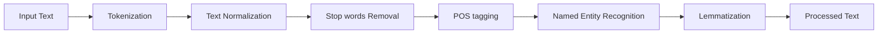

# Natural Language Processing (NLP) Overview

**Natural Language Processing (NLP)** is a subfield of Artificial Intelligence (AI) that enables computers to understand, process, analyze, and interpret human languages such as English.

NLP combines linguistics, machine learning, and deep learning techniques to help machines interact with humans using text and speech.

It is widely used in applications such as:
- Chatbots and virtual assistants
- Machine Translation
- Sentiment Analysis
- Speech Recognition
- Text Summarization
- Language Understanding

## About NLTK Library

**NLTK (Natural Language Toolkit)** is a popular Python library used for working with human language data.

It provides tools and resources for processing text, analyzing language structures, and performing various NLP operations.

### Features of NLTK

- Text Tokenization
- Stopwords Removal
- Parts of Speech (POS) Tagging
- Named Entity Recognition
- Stemming and Lemmatization
- Text Processing and Analysis

## ⚙️ Installation

Install NLTK using pip:

```bash
pip install nltk
```

Import the library:

```python
import nltk
```

### Download Required NLTK Resources

```python
nltk.download('punkt')
nltk.download('punkt_tab')
nltk.download('stopwords')
nltk.download('averaged_perceptron_tagger')
nltk.download('averaged_perceptron_tagger_eng')
nltk.download('maxent_ne_chunker')
nltk.download('maxent_ne_chunker_tab')
nltk.download('words')
nltk.download('wordnet')
nltk.download('omw-1.4')
```

## 🔍 Various NLP Techniques Used

### 1. Tokenization

Tokenization is the process of breaking a paragraph or sentence into smaller units called tokens.

Tokens can be individual words or sentences.

**Example:**

Input:
```text
Natural Language Processing is interesting.
```

Output:
```python
['Natural', 'Language', 'Processing', 'is', 'interesting', '.']
```

### 2. Text Normalization

Text Normalization is the process of converting text into a standard format to make it easier to process and analyze.

In this notebook, normalization involves:
- Removing non-alphabetic characters.
- Converting all words into lowercase.

**Example:**

Input:
```text
['Natural', 'LANGUAGE', '123', 'Processing']
```

Output:
```python
['natural', 'language', 'processing']
```

### 3. Stopwords Removal

Stopwords are commonly used words that may not contribute much meaning to a particular text analysis task.

Examples include: is, the, a, an, and, in, of, etc

Stopwords removal helps reduce unnecessary words from the text.

### 4. Parts of Speech (POS) Tagging

POS Tagging is the process of identifying the grammatical category of each word in a sentence.

It classifies words into categories such as:
- Noun (NN)
- Verb (VB)
- Adjective (JJ)
- Adverb (RB)
- Pronoun (PRP)
- Preposition (IN)

Output format:

```text
[('natural', 'JJ'), ('language', 'NN'),
 ('processing', 'NN'), ('focused', 'VBD')]
```

### 5. Named Entity Recognition (NER)

Named Entity Recognition is an NLP technique used to identify and classify important entities in text.

Examples of named entities include:
- Person Names
- Organizations
- Locations
- Dates

In this notebook, NLTK's `ne_chunk()` function is used with binary classification.

### 6. Lemmatization

Lemmatization is the process of converting words into their meaningful base or dictionary form, known as a lemma.

It helps reduce different forms of a word to a common base form.

**Examples:**

| Original Word | Lemma |
|---|---|
| cars | car |
| running | running |
| studies | study |
| better | better |

*Note: The default lemmatizer uses noun as its POS category. Providing the appropriate POS category can improve results.*

## 🔄 NLP Processing Pipeline



##  Applications of NLP

1. **Chatbots:** Understand and respond to user queries.
2. **Sentiment Analysis:** Identify positive, negative, or neutral opinions.
3. **Machine Translation:** Translate text between different languages.
4. **Speech Recognition:** Convert spoken language into text.
5. **Text Classification:** Categorize documents based on their content.
6. **Search Engines:** Understand search queries and retrieve relevant results.
